<div align="center">

# 🏆 Mundial 2026 — Un Mundial para Todos

**Plataforma de fan‑engagement para la Copa Mundial de la FIFA 2026** (México 🇲🇽 · Estados Unidos 🇺🇸 · Canadá 🇨🇦).
Álbum digital de láminas, pollas con amigos, mapa de estadios, compra de entradas y paneles de administración, soporte y backoffice.

[](https://github.com/JuaniMP/Mundial-2026/actions)


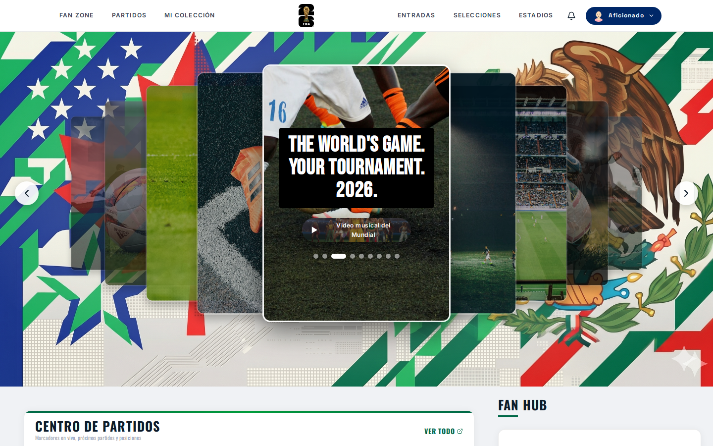

</div>

---

## 📑 Contenido

- [Qué hace](#-qué-hace)
- [Capturas](#-capturas)
- [Arquitectura](#-arquitectura)
- [Patrones de diseño](#-patrones-de-diseño)
- [Tecnologías](#-tecnologías)
- [Estructura del proyecto](#-estructura-del-proyecto)
- [Cómo ejecutarlo en local](#-cómo-ejecutarlo-en-local)
- [Cómo probarlo](#-cómo-probarlo)
- [Variables de entorno](#-variables-de-entorno)
- [API REST](#-api-rest)
- [Roadmap](#-roadmap)
- [Documentación](#-documentación)

---

## ✨ Qué hace

| Módulo | Descripción |
|---|---|
| 🔐 **Cuentas y roles** | Registro, login con JWT, recuperación de contraseña por correo y 6 roles: aficionado, admin, operador, soporte, compliance y aliado comercial. |
| 🎴 **Álbum digital** | 320 láminas de 16 selecciones, apertura de sobres, láminas repetidas, intercambios y misiones. |
| 🏆 **Pollas** | Grupos privados con código de invitación para predecir marcadores: 5 puntos por acertar el ganador, 10 por el marcador exacto. |
| 🏟️ **Estadios** | Las 16 sedes en un mapa interactivo (Leaflet + OpenStreetMap) con capacidad y ubicación. |
| 📊 **Posiciones** | Grupos A–L del Mundial 2026 y tabla general en vivo desde football-data.org. |
| ⚽ **Partidos y selecciones** | Calendario, resultados y plantillas desde football-data.org (caché de 5 minutos). |
| 🎟️ **Entradas** | Compra por categoría con Stripe Checkout (sandbox) y webhooks de confirmación. |
| ✈️ **Agentes de viaje** | Sugerencias de lugares cerca de cada sede (OpenTripMap / Overpass). |
| 🔔 **Notificaciones** | Push con Firebase Cloud Messaging e historial dentro de la app. |
| 🛠️ **Soporte** | Buscador de aficionados con línea de tiempo de actividad, gestión de incidentes y acciones correctivas (reenviar confirmación, reembolso…). |
| 🗂️ **Backoffice** | Alertas antifraude, auditoría de logs, gestión de cuentas, resultados manuales y comunicados masivos. |
| 🌐 **Idiomas** | Español, inglés y francés (i18next). |

---

## 📸 Capturas

> Tomadas con el proyecto corriendo en local con el perfil `dev`. Las pantallas de partidos, selecciones y entradas necesitan una clave de [football-data.org](https://www.football-data.org/) y por eso no aparecen aquí.

### Aficionado

| Inicio de sesión | Registro |
|---|---|
| 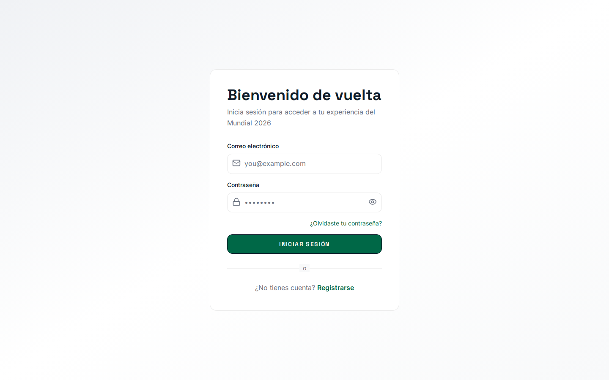 | 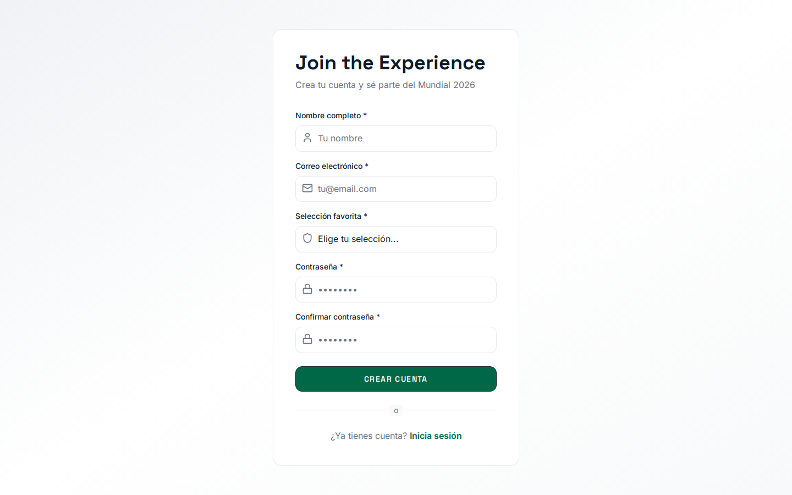 |

| Álbum digital | Pollas |
|---|---|
| 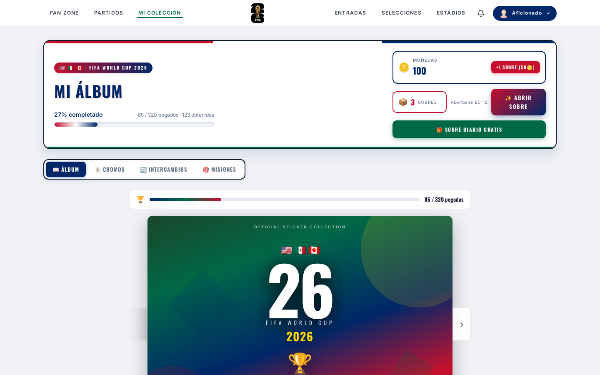 | 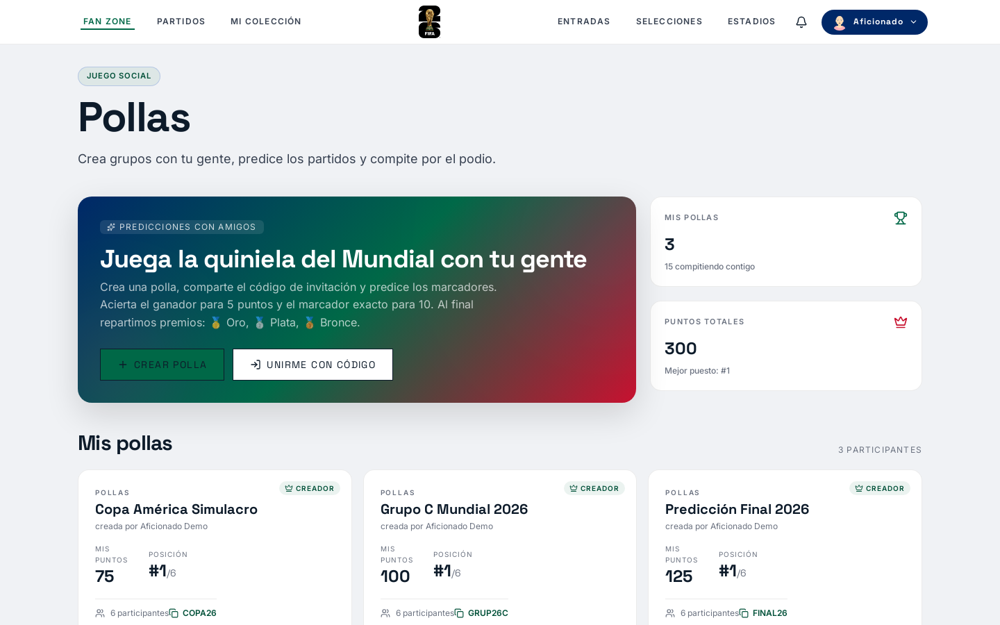 |

| Mapa de estadios | Tabla de posiciones (grupos A–L) |
|---|---|
| 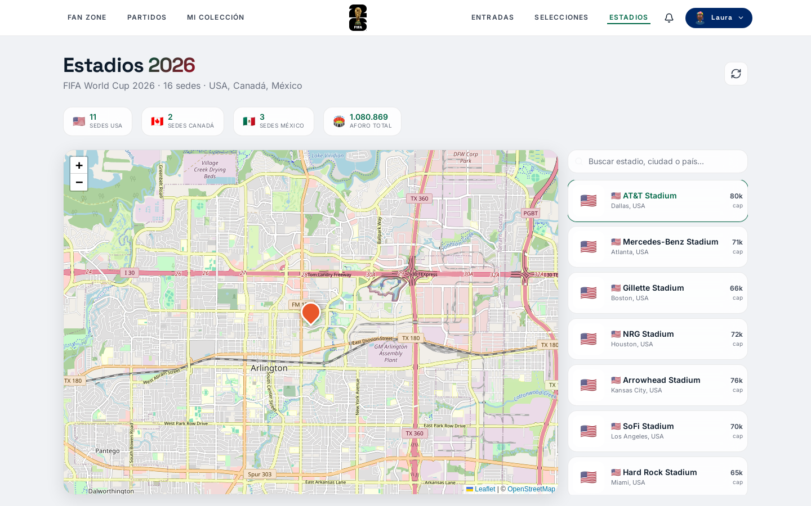 | 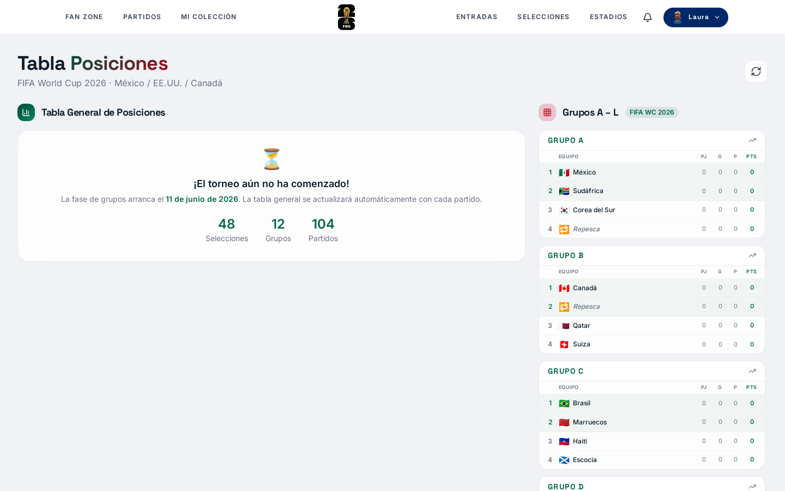 |

| Perfil |
|---|
| 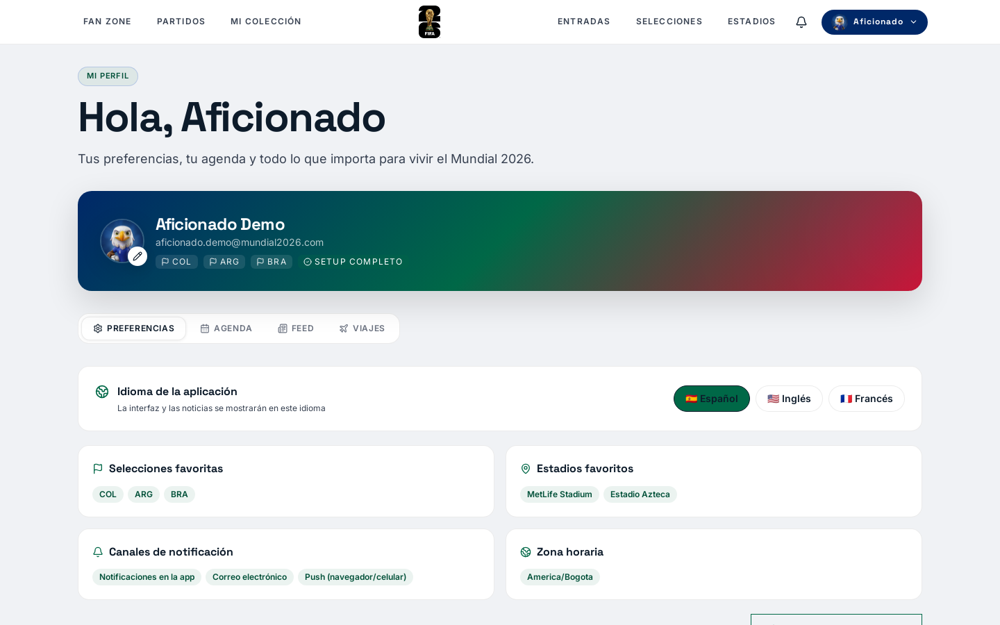 |

### Administración y soporte

| Panel de administración | Backoffice |
|---|---|
| 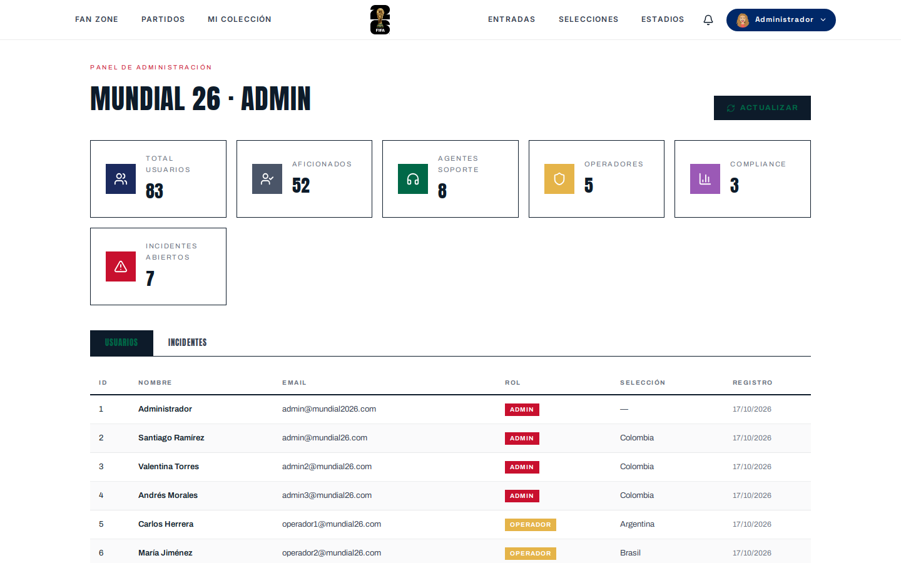 | 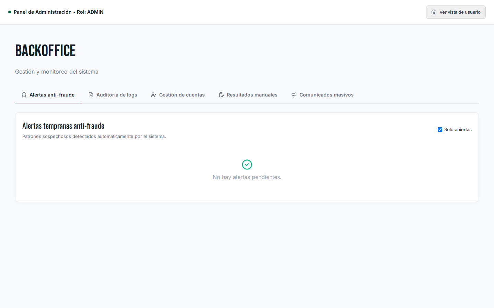 |

| Centro de atención al aficionado | Gestión de incidentes |
|---|---|
| 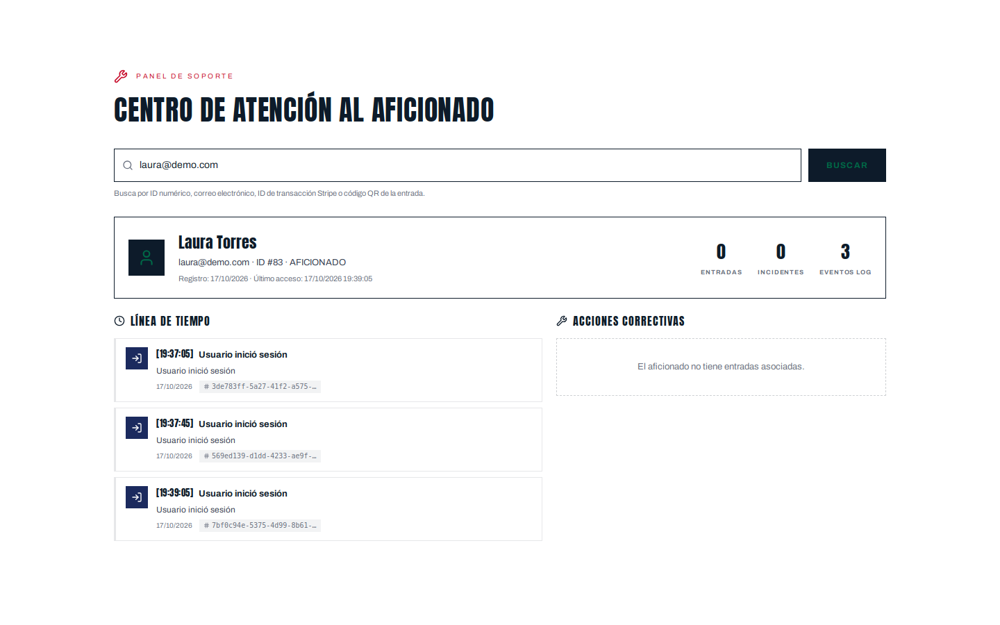 | 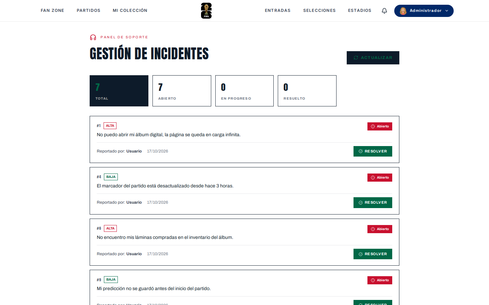 |

---

## 🏗 Arquitectura

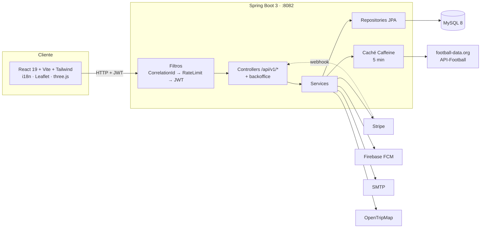

Cada petición recibe un `correlationId` que aparece en todos los logs; `RateLimitFilter` (Bucket4j) limita peticiones por IP; `JwtAuthFilter` valida el token y los endpoints sensibles exigen rol con `@PreAuthorize`. Los datos del torneo vienen de APIs externas y se cachean para respetar sus límites gratuitos.

---

## 🧩 Patrones de diseño

| Patrón | Dónde se aplica | Para qué |
|---|---|---|
| **Arquitectura en capas** | `controller/` → `service/` → `repository/` (y su espejo en `backoffice/`) | Separar HTTP, reglas de negocio y datos. |
| **Repository** | `repository/*Repository.java` (Spring Data JPA) | Acceso a datos sin SQL repetido. |
| **DTO** | `dto/` y `dto/football/` | Contratos de API independientes de las entidades. |
| **Envelope / Wrapper** | `ApiResponse<T>` con `success()` y `error()` | Todas las respuestas tienen la misma forma `{ success, message, data }`. |
| **Builder** | `@Builder` de Lombok en 59 clases | Crear entidades y DTO legibles sin constructores enormes. |
| **Adapter** | `FootballDataService`, `ApiFootballService` | Traducen las APIs externas a los DTO propios. |
| **Cache‑Aside** | `@Cacheable` en `FootballDataService` (Caffeine, 5 min) | No agotar los límites gratuitos de football-data.org. |
| **Token Bucket** | `RateLimitFilter` con Bucket4j | Limitar peticiones por IP. |
| **Chain of Responsibility** | `CorrelationIdFilter` → `RateLimitFilter` → `JwtAuthFilter` | Cada filtro procesa o corta la petición. |
| **Singleton** | `FirebaseService` (una sola `FirebaseApp`) | Inicializar Firebase una vez aunque se recargue el contexto. |
| **Principal del token** | `security/UsuarioActual` + `@AuthenticationPrincipal` | El usuario sale del JWT, nunca de la URL. |
| **Provider / Context** (React) | `AuthContext`, `LanguageContext` | Sesión e idioma globales. |
| **Route Guard** | `PrivateRoute`, `RoleRoute` | Proteger pantallas por sesión y por rol. |
| **Componentes de presentación** | `components/ui/` (`Button`, `StatCard`, `Badge`…) | Piezas visuales reutilizables. |
| **Service layer** (frontend) | `services/*Api.ts` sobre `services/http.ts` | Una sola URL base y una sola forma de autenticar las peticiones. |
| **Lazy loading** | `lazyPage()` en `App.tsx` | Bundle inicial de 1,1 MB → 390 KB. |

---

## 🛠 Tecnologías

| Capa | Tecnologías |
|---|---|
| **Frontend** | React 19, TypeScript, Vite 8, Tailwind CSS 4, React Router 7, i18next, Leaflet, three.js / React Three Fiber, Stripe.js, Firebase |
| **Backend** | Java 17, Spring Boot 3.2 (Web, Security, Data JPA, Validation, Mail, Cache, Actuator), JJWT, Bucket4j, Caffeine, Stripe Java, Firebase Admin, springdoc (Swagger) |
| **Base de datos** | MySQL 8 (esquema gestionado por Hibernate) |
| **Calidad** | GitHub Actions (build, lint, typecheck, Prettier), JUnit 5 + Mockito |
| **Despliegue** | Backend en Fly.io, frontend en Vercel |

---

## 📂 Estructura del proyecto

```
Mundial-2026/
├── backend/                         API REST (Spring Boot + Maven)
│   └── src/main/java/co/edu/unbosque/
│       ├── config/                  seguridad, CORS, filtros, seeders
│       ├── controller/              API pública  ·  controller/backoffice/  API interna
│       ├── service/                 reglas de negocio  ·  service/backoffice/
│       ├── security/                JWT y usuario autenticado
│       ├── entity/  repository/     modelo y acceso a datos
│       ├── dto/  dto/football/      contratos de entrada/salida
│       └── exception/               manejo global de errores
├── frontend/world-cup-2026/         SPA (React + Vite)
│   └── src/
│       ├── pages/                   una pantalla por archivo (+ backoffice/)
│       ├── components/              ui/, features/, album/, layout/…
│       ├── services/                clientes de la API (http.ts compartido)
│       ├── context/  i18n/          sesión, idioma y traducciones (es/en/fr)
│       └── config.ts                URL del backend
├── basededatos/                     cómo se crea y siembra la base de datos
├── docs/                            arquitectura (ADRs, C4), diseño, producto, runbooks, capturas
├── docker-compose.yml               MySQL 8 para desarrollo
└── .github/workflows/ci.yml         integración continua
```

---

## 🚀 Cómo ejecutarlo en local

### Requisitos

| Herramienta | Versión |
|---|---|
| Java (JDK) | 17+ |
| Maven | 3.9+ |
| Node.js | **20.19+** (lo exige Vite 8; ver `.nvmrc`) |
| MySQL | 8.x o superior (probado con 9.7) — o Docker |
| [Mailpit](https://mailpit.axllent.org/) | opcional: atrapa los correos de recuperación de contraseña |

### 1. Clonar e instalar

```bash
git clone https://github.com/JuaniMP/Mundial-2026.git
cd Mundial-2026
npm install
```

### 2. Base de datos

Cualquiera de las dos:

- **MySQL local** en el puerto 3306 con usuario `root` sin contraseña: no hay que configurar nada más.
- **Docker:** `npm run db:start` y define `DB_URL`, `DB_USER` y `DB_PASSWORD` como se explica en [`basededatos/README.md`](basededatos/README.md).

Las tablas se crean solas al arrancar el backend.

### 3. Backend

```bash
cd backend
SPRING_PROFILES_ACTIVE=dev mvn spring-boot:run
```

El perfil `dev` (`application-dev.properties`) activa un secreto JWT de desarrollo, el correo con Mailpit (`localhost:1025`) y los **datos de demostración**.
API en `http://localhost:8082` · Swagger en `http://localhost:8082/swagger-ui.html`.

Para ver partidos, selecciones y la tabla general en vivo, añade tu clave gratuita: `FOOTBALL_DATA_KEY=tu_clave`.

### 4. Frontend

```bash
cp frontend/world-cup-2026/.env.example frontend/world-cup-2026/.env.local   # Stripe y Firebase (opcional)
npm run dev
```

Abre `http://localhost:5173`.

### Cuentas de demostración (solo perfil `dev`)

| Rol | Correo | Contraseña |
|---|---|---|
| Administrador | `admin@mundial2026.com` | `Admin2026!` |
| Soporte | `agente1@mundial26.com` | `Soporte2026!` |
| Aficionado | `aficionado.demo@mundial2026.com` | `Aficionado2026!` |

> En producción no se crea ninguna de estas cuentas: el administrador inicial solo existe si defines `ADMIN_PASSWORD`, y los datos de demostración requieren `SEED_DEMO_DATA=true`.

---

## 🧪 Cómo probarlo

```bash
cd backend && mvn verify                     # compila y ejecuta las pruebas del backend
npm run lint && npm run typecheck && npm run build   # frontend
```

**Recorrido sugerido:**

1. Regístrate como aficionado y entra a **Mi colección**: crea tu álbum, abre un sobre y pega una lámina.
2. Ve a **Fan Zone → Pollas**, crea una polla y comparte el código.
3. Reinicia el backend: tu álbum y tu agenda siguen ahí.
4. Entra como `admin@mundial2026.com`: revisa **Admin** (usuarios e incidentes) y **Backoffice**.
5. En **Soporte**, busca tu correo y verás tu línea de tiempo de actividad.

---

## 🔑 Variables de entorno

Ninguna clave real vive en el código: todo se lee del entorno. Plantillas: [`backend/.env.local.example`](backend/.env.local.example) y [`frontend/world-cup-2026/.env.example`](frontend/world-cup-2026/.env.example).

### Backend

| Variable | Descripción | Por defecto |
|---|---|---|
| `DB_URL` / `DB_USER` / `DB_PASSWORD` | Conexión MySQL | `localhost:3306`, `root`, vacío |
| `JWT_SECRET` | Secreto Base64 (≥ 256 bits) para firmar JWT | **obligatorio** fuera de `dev` |
| `ADMIN_EMAIL` / `ADMIN_PASSWORD` | Administrador inicial | sin contraseña no se crea |
| `SEED_DEMO_DATA` | Cuentas y datos ficticios | `false` (`true` en `dev`) |
| `SQL_INIT_MODE` | `always` ejecuta `pre-init.sql`, que **borra** tablas | `never` |
| `MAIL_HOST` / `MAIL_USERNAME` / `MAIL_PASSWORD` | SMTP | Gmail sin credenciales |
| `FOOTBALL_DATA_KEY` | football-data.org | vacío |
| `APIFOOTBALL_KEY` | API-Football (eliminatorias) | vacío |
| `OPENTRIPMAP_KEY` | Agentes de viaje | vacío |
| `STRIPE_SECRET_KEY` / `STRIPE_PUBLISHABLE_KEY` / `STRIPE_WEBHOOK_SECRET` | Pagos (sandbox) | placeholders |
| `FIREBASE_ENABLED` / `FIREBASE_SERVICE_ACCOUNT_FILE` | Notificaciones push | `false` |
| `CORS_ORIGINS` | Orígenes permitidos | `localhost:5173…` |

### Frontend

| Variable | Descripción |
|---|---|
| `VITE_API_URL` | URL del backend sin `/api/v1` (por defecto `localhost:8082` en desarrollo y Fly.io en el build) |
| `VITE_STRIPE_PK` | Clave publicable de Stripe |
| `VITE_FIREBASE_*` | Configuración de Firebase y clave VAPID |

---

## 🔌 API REST

Todas las rutas están bajo `/api/v1`. Documentación interactiva completa en **Swagger UI**.

| Recurso | Endpoints principales |
|---|---|
| Auth | `POST /auth/register` · `POST /auth/login` · `POST /auth/forgot-password` · `POST /auth/reset-password` |
| Álbum (usuario del token) | `GET /album` · `POST /album/crear` · `POST /album/abrir-paquete` · `GET /album/laminas` · `GET /album/todas` · `POST /album/pegar/{laminaId}` |
| Pollas | `GET/POST /pollas` · `GET /pollas/mis-pollas` · `POST /pollas/unirse/{codigo}` · `GET /pollas/{id}/ranking` · `POST /pollas/predicciones` |
| Perfil | `GET/PUT /perfil/preferencias` · `GET/POST /perfil/agenda` |
| Fútbol | `GET /football/matches` · `GET /football/standings` · `GET /football/teams` · `GET /estadios` |
| Entradas | `GET /entradas/precios` · `POST /entradas/checkout` · `POST /entradas/webhook` · `GET /entradas/mis-entradas` |
| Notificaciones | `POST /notifications/fcm-token` · `GET /notifications/mis-notificaciones` |
| Soporte *(ADMIN, SOPORTE)* | `GET /soporte/buscar?q=` · `GET /soporte/timeline/{id}` · `GET /soporte/incidentes` · `POST /soporte/acciones/reembolso/{entradaId}` |
| Backoffice *(ADMIN, COMPLIANCE)* | `/backoffice/alertas` · `/backoffice/logs` · `/backoffice/usuarios` · `/backoffice/resultados-manual` · `/backoffice/comunicados` |

---

## 🗺 Roadmap

| Sprint | Entregables | Estado |
|---|---|---|
| **1 — Foundations** | Auth JWT, entidades base, correo, football-data | ✅ |
| **2 — Core** | Estadios, partidos, álbum, pollas, posiciones | ✅ |
| **3 — Pagos** | Stripe Checkout, webhooks, historial | ✅ |
| **4 — Notificaciones** | Firebase FCM, grupos A–L | ✅ |
| **5 — Hardening** | Seguridad (secretos fuera del código, control de acceso), pruebas, rendimiento | 🔄 En curso |
| **6 — Deploy** | Dominio, CI/CD completo | ⏳ |

---

## 📚 Documentación

| Documento | Contenido |
|---|---|
| [`docs/architecture/ARCHITECTURE.md`](docs/architecture/ARCHITECTURE.md) | Diagramas C4 y flujos de datos |
| [`docs/architecture/adrs/`](docs/architecture/adrs/) | Decisiones de arquitectura |
| [`docs/design-system/DESIGN.md`](docs/design-system/DESIGN.md) | Sistema de diseño *Diplomatic Gallery* |
| [`docs/product/spec.md`](docs/product/spec.md) | Especificación funcional e historias de usuario |
| [`docs/runbooks/`](docs/runbooks/) | Procedimientos operativos |
| [`CONTRIBUTING.md`](CONTRIBUTING.md) | Ramas, commits y pull requests |

---

<div align="center">

Hecho por **[Juanita Mejía](https://github.com/JuaniMP)** y contribuidores · Licencia [MIT](LICENSE)

</div>
